# PROTOTYPE: dead `surface`/`primary` classes, once they apply

Throwaway, for [How should the dead surface/primary classes look once they apply?](https://github.com/florianBieck/lesbarkeitsindex/issues/56)
on the map [#46](https://github.com/florianBieck/lesbarkeitsindex/issues/46). This branch is never merged.

## Variants

All four render on the real routes, switched with `?variant=A|B|C|D` (the floating bar or `←`/`→`).

| Key | Name                  | What it shows                                                                                                                                   |
| --- | --------------------- | ----------------------------------------------------------------------------------------------------------------------------------------------- |
| A   | today                 | The prod build as it is: the classes generate no CSS, PrimeVue beats the utilities on its components                                            |
| B   | all live              | What `tailwindcss-primeui` + PrimeVue `cssLayer` would do: every `*-surface-*`/`text-primary` maps to `var(--p-*)`, utilities beat PrimeVue      |
| C   | live + AA fix         | B, plus `text-surface-400` → surface-500 (2.56 → 4.76:1) and `text-primary` → primary-700 (2.54 → 5.48:1)                                         |
| D   | proposal              | Colours live with the AA fix, but: `AppLogo` deleted, logout band deleted, separators surface-200, utilities on PrimeVue components deleted       |

**How it's emulated:** the app stays on Tailwind 3.4. `app/assets/prototype-dead-classes.css` adds rules under `:root[data-proto-*]`
attributes that the switcher sets. Colours are exact, since they read PrimeVue's own `--p-surface-*`/`--p-primary-*` variables.
`cssLayer` is emulated by specificity. The Tailwind 4 renames (`shadow-sm` → `shadow-xs` and the others) are not applied: they belong to PR 3.

**Shoot against a prod build, not `nuxt dev`.** Under `nuxt dev` the CSS loads in a different order and the utilities already beat
PrimeVue in A. The login button measured 50px/8px radius in dev, but 42px/6px in the prod build.

## Run it

```sh
docker compose up -d                                      # Postgres + R sidecar
(cd apps/backend && pnpm exec nest build --builder swc && node dist/main.js)
cd apps/frontend && pnpm exec nuxt build
PORT=3001 NUXT_PUBLIC_PROTOTYPE_SWITCHER=true pnpm exec nuxt preview   # http://localhost:3001/?variant=B
pnpm exec playwright test -c prototype-dead-classes shoot              # → shots/
python3 prototype-dead-classes/compose.py prototype-dead-classes       # → side-by-side/
```

## By class group

Counts are from the research ([findings](https://github.com/florianBieck/lesbarkeitsindex/blob/research/tailwind4-primevue/docs/research/2026-10-24-tailwind4-primevue.md)).

### 1. Text hierarchy: `text-surface-900` ×17, `-700` ×15, `-600` ×3, `-500` ×13

Headings and values go from the inherited slate-700 to slate-900. Muted lines go to slate-500 (4.76:1) or slate-600 (7.58:1); both pass AA.
`-700` changes nothing, because slate-700 is what the text inherits today.

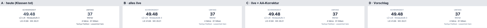
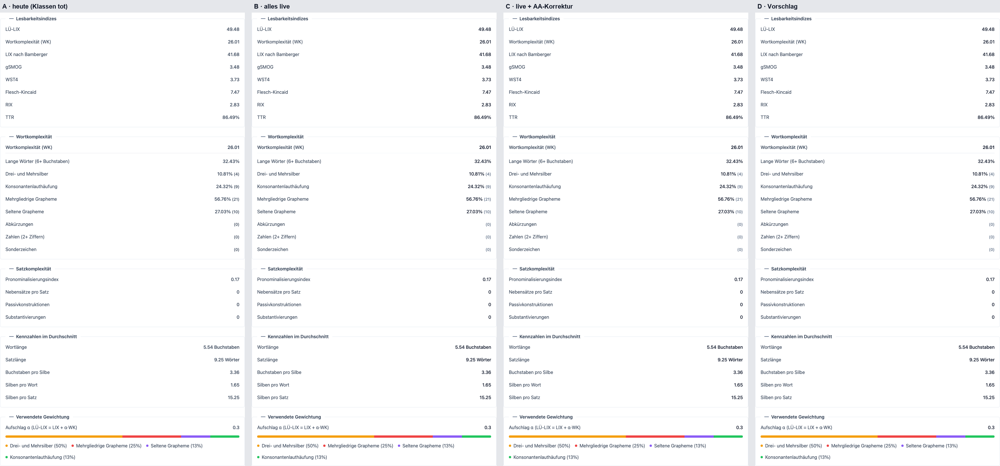
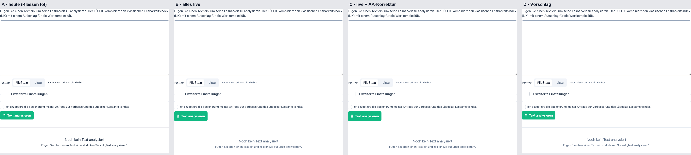

### 2. Hints: `text-surface-400` ×2 (`config-weights-form.vue`)

B is slate-400 at 2.56:1, which fails AA. C and D use slate-500.

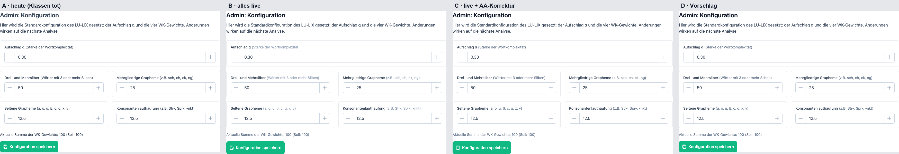

### 3. Link: `text-primary` ×1 (the "Startseite" link in the `/results` empty state)

B is emerald-500 at 2.54:1, which fails AA. C and D use emerald-700.

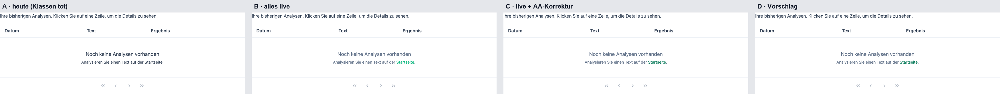

### 4. `AppLogo`: `fill-surface-700` ×1 (`/login`, `/logout`)

Once it applies, the PrimeBlocks **placeholder** logo (the striped circle) appears above "Anmelden". It is not the client's logo. Today it is
invisible but still takes up 56px. D deletes it.

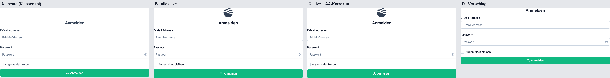

### 5. Header logo box: `bg-surface-0` + `outline-surface-0` (`app.vue`, every page)

Today the frame is dark (3.5px of `currentColor`, slate-700). Live, it's white, and the box blends into the white card below the banner.

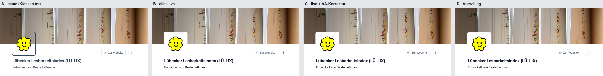

### 6. Backgrounds: `bg-surface-50` ×1 (`/logout`), `bg-surface-0` ×3

`bg-surface-50` puts a light grey band behind the logout card, inside the page card. D deletes it. `bg-surface-0` makes no visible
difference anywhere except the logo box (group 5), because the card is white already.

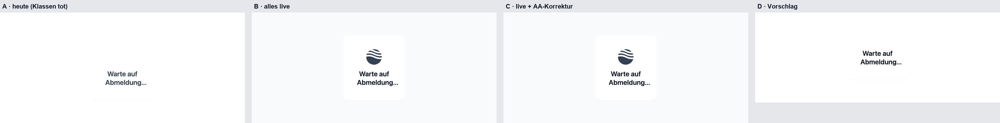

### 7. Separators: `border-surface-100` ×3 (`result-view.vue` ×2, `index.vue`)

Today they're gray-200, from Preflight. Live, they're slate-100 (1.1:1 against white), so they nearly vanish. D uses surface-200, which is
about today's gray-200.

### 8. Utilities on PrimeVue components

These are `py-3 rounded-lg` on three Buttons (login, start page, admin), `px-3 py-2 shadow-sm rounded-lg` on the login `InputText`, and
`text-base! leading-normal!` on the login button icon. Live, the three buttons grow from 42px to 50px with an 8px radius, while every other
PrimeVue control keeps 6px. The email field gets 8px next to the password field's 6px. D deletes them, which keeps today's look.

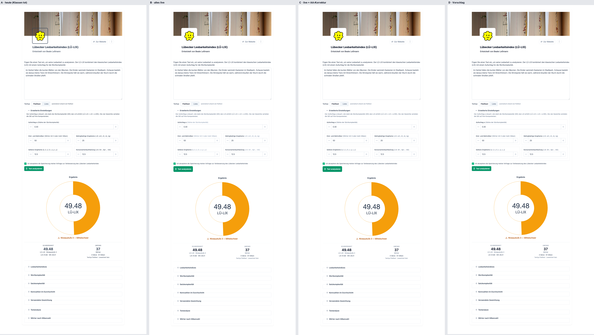
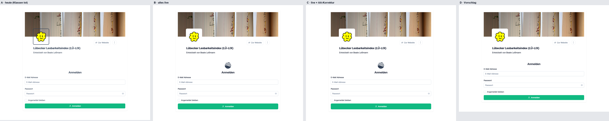
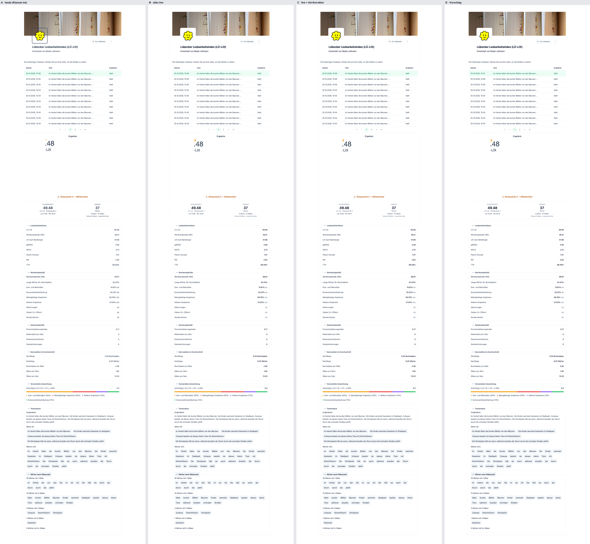
