# THROWAWAY: visual check for PR 3 (Tailwind 3.4 → 4)

For [PR 3: move the frontend from Tailwind 3.4 to 4](https://github.com/florianBieck/lesbarkeitsindex/issues/63) on the map
[Map: refactor the frontend from Nuxt 4 to a plain Vue 3 SPA](https://github.com/florianBieck/lesbarkeitsindex/issues/46). This branch is never merged.

Each sheet puts three panels side by side:

| Panel                          | Source                                                                                                                                                                                                                                  |
| ------------------------------ | --------------------------------------------------------------------------------------------------------------------------------------------------------------------------------------------------------------------------------------- |
| **main · Tailwind 3.4**        | `main` at `e6056a1`, prod build                                                                                                                                                                                                         |
| **Ziel · Prototyp Variante D** | Panel D cropped from the [dead-classes prototype](https://github.com/florianBieck/lesbarkeitsindex/blob/prototype/dead-surface-classes/apps/frontend/prototype-dead-classes/README.md)'s sheets (Nuxt, Tailwind 3.4, D emulated in CSS) |
| **PR 3 · Tailwind 4**          | `refactor/frontend-tailwind-4`, prod build                                                                                                                                                                                              |

Both builds were served by the backend itself (as in CI), Chromium at 1280×900. `not-found` has no D panel: PR 2 added that page after the prototype.

## Result

PR 3 matches variant D. Pixel diff of PR 3 against panel D (threshold 24/255):

| Page                                                                             | Differs from D            | Why                                                                                                                                                                                                    |
| -------------------------------------------------------------------------------- | ------------------------- | ------------------------------------------------------------------------------------------------------------------------------------------------------------------------------------------------------ |
| admin, header, login-form, logout, result-details, result-metrics, results-empty | 0.00 %                    | identical                                                                                                                                                                                              |
| login, index-result, results (full page)                                         | 1–2 %, all below y≈494    | Everything below the header moves up 1px: v4's `leading-normal` beats `md:text-lg`'s line-height on the subtitle (28 → 27px), a v4 default the Tailwind decision accepted                              |
| index-empty                                                                      | 0.36 %, the textarea only | The prototype's run left the mouse over the textarea: all four of its panels, A ("today") included, show PrimeVue's hover border (slate-400). `main` and PR 3 both show the resting border (slate-300) |

Against `main`, PR 3 changes what D intends: the white logo frame, slate-900 headings and values, slate-500/600 muted text, `surface-200` borders, emerald-700 links, and no placeholder logo (login form and logout card 72px shorter).

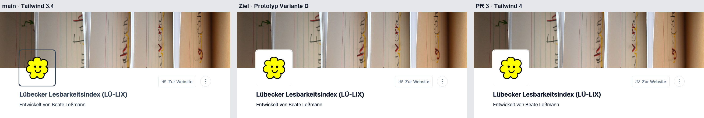
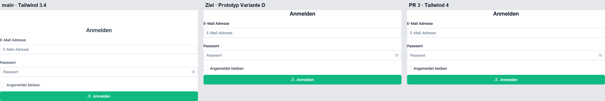
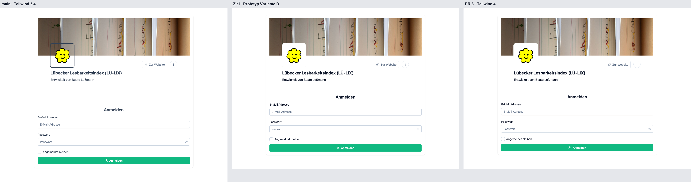
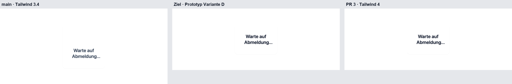
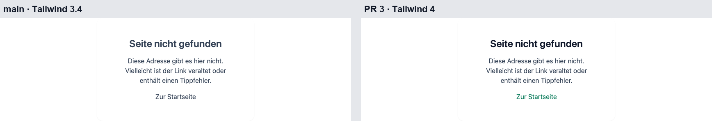
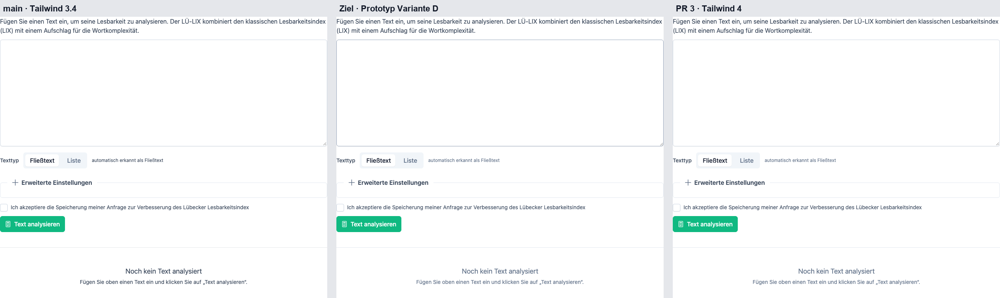
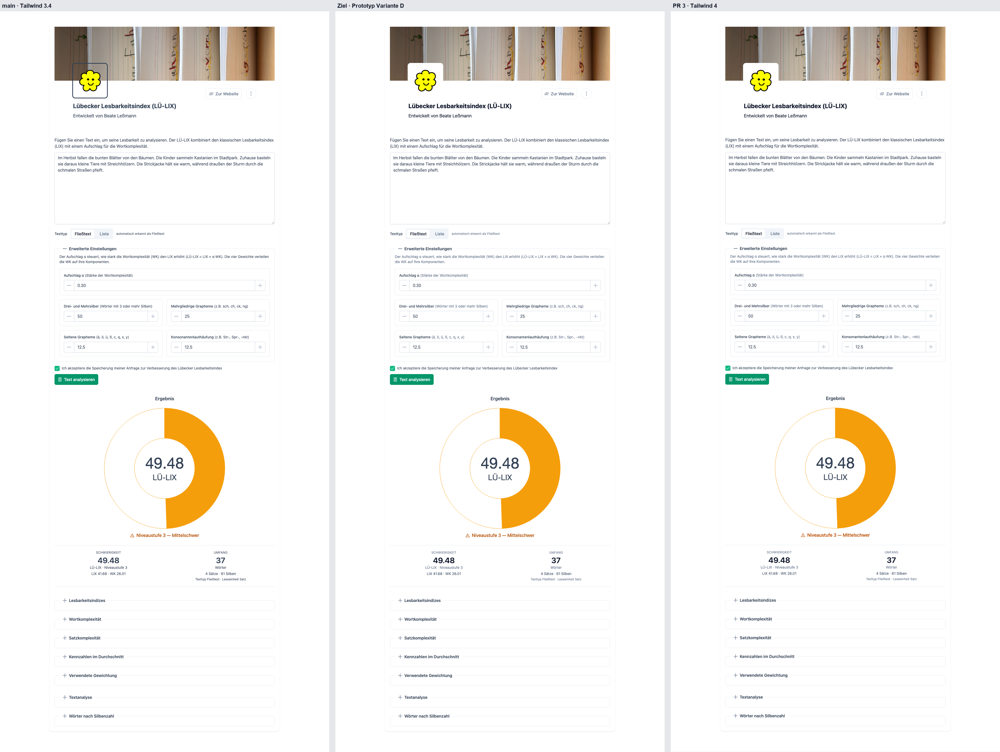
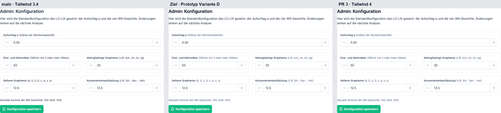
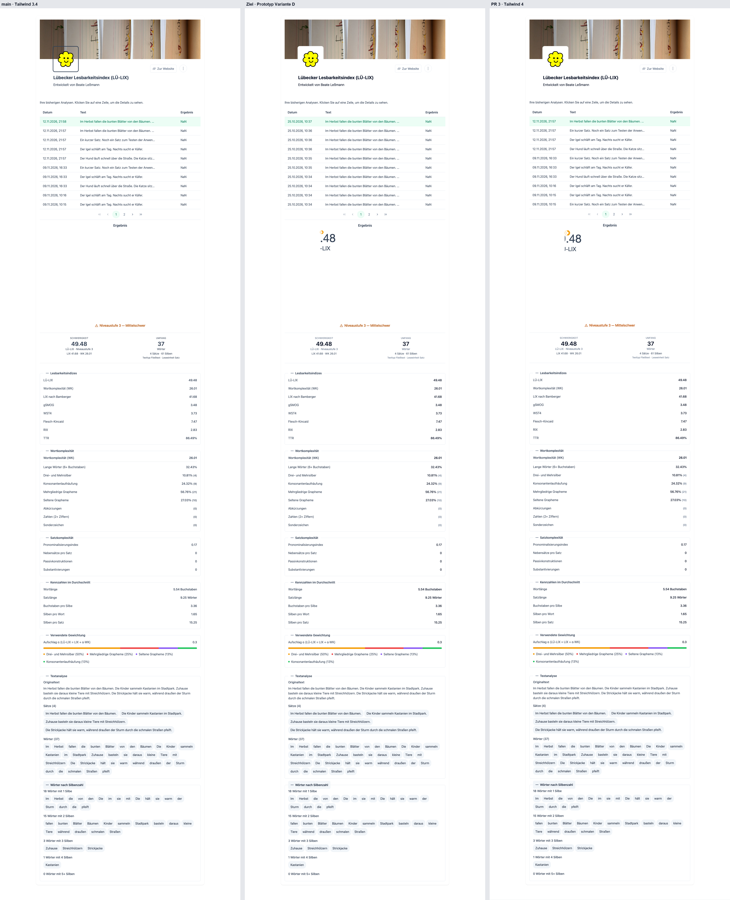
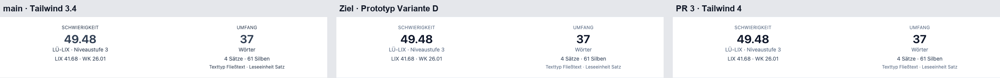
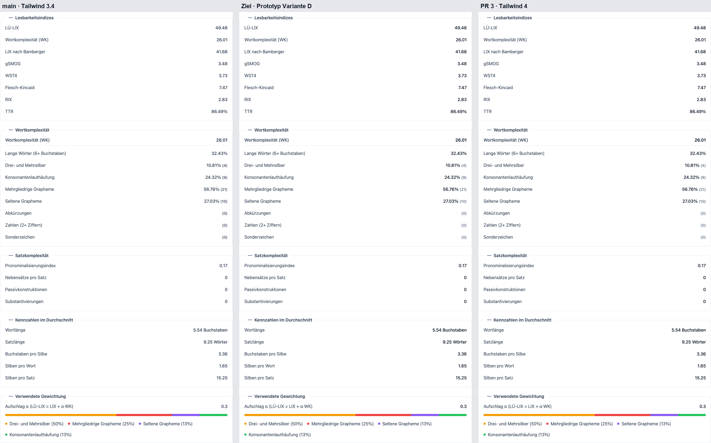
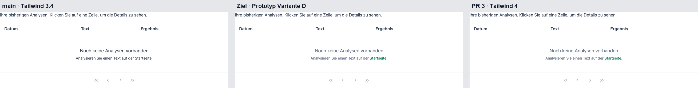

## Rerun it

Needs Postgres and the R sidecar (`docker compose up -d`) and the backend serving a fresh `pnpm --filter @lesbarkeitsindex/frontend run build` (`pnpm --filter backend run build && node apps/backend/dist/main.js`; the default base URL here is `http://localhost:3002`, set `SHOOT_BASE_URL` for :3000).

```sh
cd apps/frontend
SHOOT_LABEL=pr3 pnpm exec playwright test -c visual-tailwind4 shoot     # → shots/*-pr3.png; repeat with a main build and SHOOT_LABEL=main
python3 visual-tailwind4/compose.py visual-tailwind4/shots <dir with the prototype's side-by-side PNGs> visual-tailwind4/side-by-side
```
